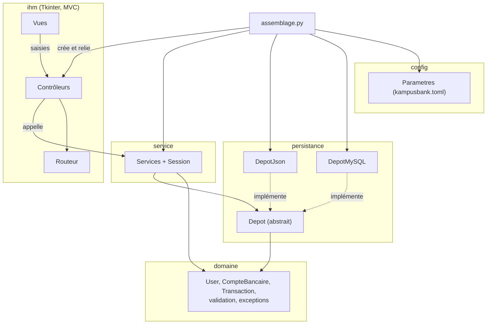
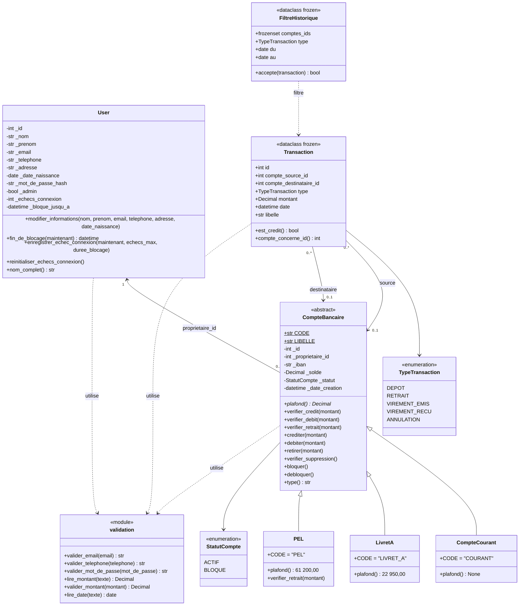
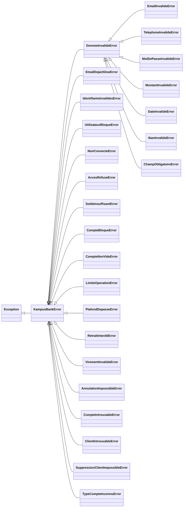
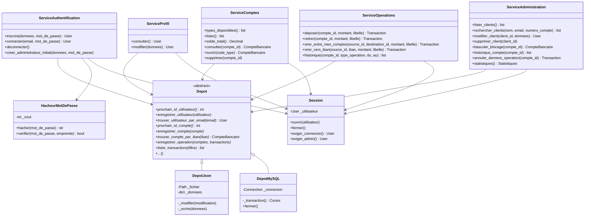
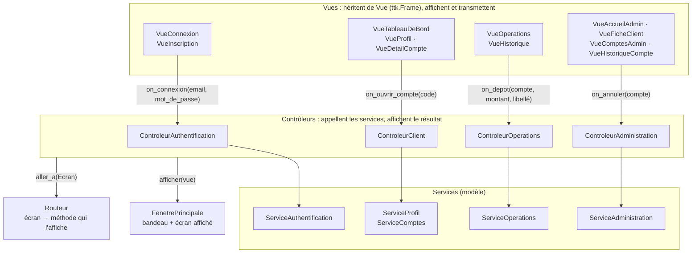

# Diagramme de classes UML

Le diagramme est découpé par couche pour rester lisible. Les attributs privés
sont préfixés par `-`, les éléments publics par `+`. Les propriétés en lecture
seule (`@property`) apparaissent comme des méthodes sans paramètre.

## 1. Vue d'ensemble des couches

## 2. Domaine

## 3. Exceptions métier

## 4. Services et persistance

## 5. Interface (MVC)

Vue simplifiée : toutes les vues héritent de `Vue` (un `ttk.Frame`), et chaque
contrôleur ne parle qu'à son service.

