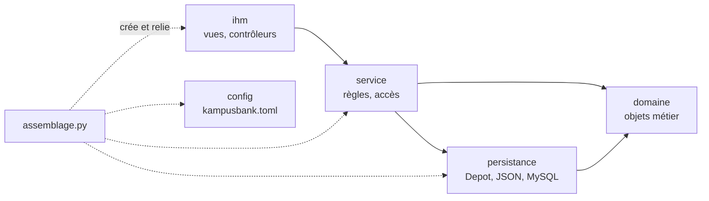
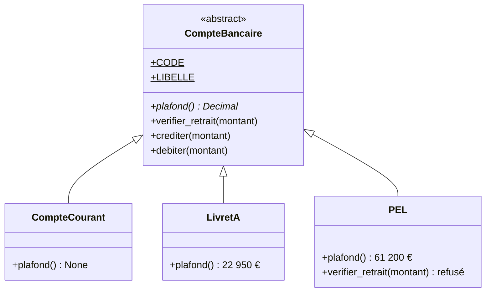
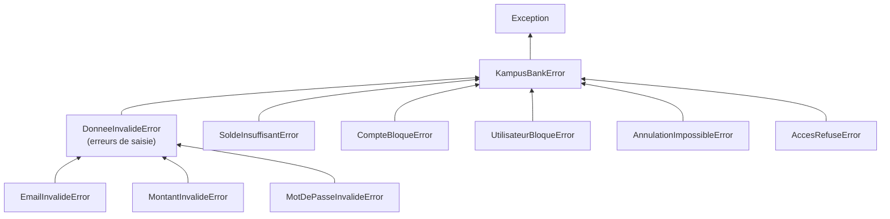
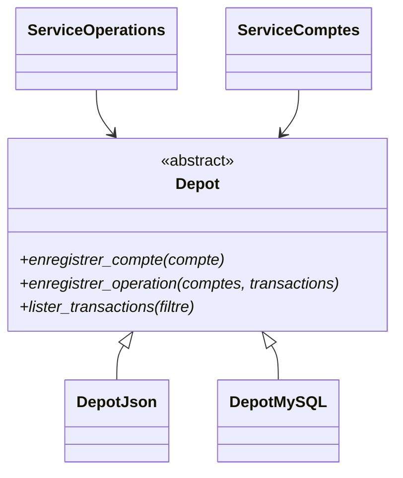
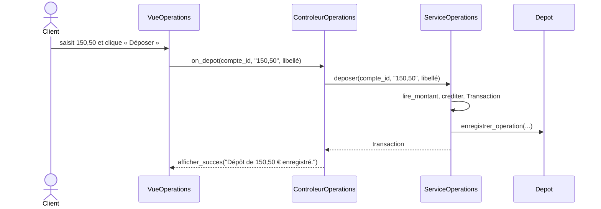

# KampusBank : dossier de conception

Application de bureau de gestion bancaire, écrite en Python. Ce dossier explique
comment chaque exigence de conception (EC1 à EC10) est respectée et indique les
fichiers concernés.

## 1. Présentation

KampusBank propose deux espaces, accessibles après authentification :

- **client** : inscription, connexion, tableau de bord, profil, ouverture, détail
  et suppression de comptes (courant, Livret A, PEL), dépôt, retrait, virement
  entre ses comptes ou vers un autre client par IBAN, historique filtrable par
  compte, type d'opération et période ;
- **administrateur** : statistiques, recherche combinée des clients (nom, email,
  numéro de compte), fiche client modifiable, suppression d'un client, liste de
  tous les comptes, blocage et déblocage, historique d'un compte, annulation de
  la dernière opération.

| Élément | Choix |
|---|---|
| Langage | Python 3.12+ (annotations de type partout) |
| Interface | Tkinter / ttk, architecture MVC |
| Persistance | JSON (par défaut) ou MySQL via PyMySQL, au choix dans la configuration |
| Mots de passe | bcrypt (coût réglable) |
| Configuration | `kampusbank.toml`, lu avec `tomllib` |
| Qualité | pytest (environ 190 tests), mypy en mode strict, ruff (PEP 8, docstrings) |

Installation, tests et lancement sont décrits dans le `README.md`.

## 2. EC1 : découpage en couches

Le code est un paquet `kampusbank` découpé en cinq sous-paquets ; chaque couche
ne dépend que de celles qui sont en dessous.

| Couche | Rôle | Fichiers |
|---|---|---|
| `domaine` | Objets métier et règles qui ne dépendent de rien : `User`, `CompteBancaire` et ses sous-classes, `Transaction`, validation, exceptions | `domaine/*.py` |
| `service` | Cas d'utilisation et contrôle d'accès : authentification, comptes, opérations, administration, session | `service/*.py` |
| `persistance` | Enregistrement des données derrière la classe abstraite `Depot` | `depot.py`, `depot_json.py`, `depot_mysql.py` |
| `ihm` | Fenêtre, vues et contrôleurs Tkinter | `ihm/vues/*`, `ihm/controleurs/*` |
| `config` | Lecture de `kampusbank.toml` en objets typés | `config/parametres.py` |

Le module `assemblage.py` est le seul endroit qui choisit les implémentations
concrètes et relie les objets entre eux.

La règle de dépendance est vérifiée automatiquement par
`tests/test_architecture.py`. Ce test lit les `import` de chaque fichier avec le
module `ast` et échoue si :

- le domaine importe `tkinter`, `json` ou une autre couche ;
- un service importe l'interface ;
- l'interface importe la persistance ou la configuration.

## 3. EC2 : hiérarchie de comptes

`CompteBancaire` est une classe abstraite (`ABC`). La propriété `plafond` est
abstraite : chaque sous-classe doit dire si elle est plafonnée.

Les comportements propres à chaque type sont portés par les classes, jamais par
des tests `if type == ...` :

- le **plafond** est une propriété redéfinie : aucun pour le compte courant,
  22 950 € pour le Livret A, 61 200 € pour le PEL ;
- le **PEL** redéfinit `verifier_retrait` pour refuser les retraits d'espèces.
  L'argent n'en sort que par virement, sinon un PEL non vide ne pourrait jamais
  être supprimé (RG6).

Chaque sous-classe s'inscrit d'elle-même dans un registre grâce à
`__init_subclass__`. Le service d'ouverture de compte, la liste déroulante de
l'interface et la relecture des données (JSON ou MySQL) passent par ce registre
(`types_de_compte`, `classe_de_compte`). **Ajouter un type de compte consiste à
écrire une sous-classe**, et rien d'autre : le test
`test_ajouter_un_type_suffit_d_ecrire_une_sous_classe` le démontre avec un Livret
Jeune.

Fichiers : `domaine/comptes.py`, `tests/test_comptes.py`.

## 4. EC3 : encapsulation

- Tous les attributs internes sont préfixés par `_` et exposés en lecture par des
  `@property` sans setter. Écrire `compte.solde = 1000` lève `AttributeError`.
- Le solde ne change que par `crediter` et `debiter`. Chacune vérifie, dans
  l'ordre, que le montant est valide (RG17), que le compte est actif (RG7), que
  le plafond est respecté et que le solde reste positif (RG9, RG10). Un débit
  supérieur au solde lève `SoldeInsuffisantError` sans rien modifier.
- `User` ne se modifie que par `modifier_informations`, qui valide **tous** les
  champs avant d'en changer un seul : une modification invalide laisse l'objet
  intact.
- Les constructeurs n'acceptent que des arguments nommés (`*`), ce qui évite
  d'inverser deux paramètres.
- `Transaction` est une `dataclass(frozen=True)` : une opération inscrite à
  l'historique ne peut plus être modifiée.
- Au niveau de la base MySQL, la contrainte `CHECK (solde >= 0)` est une seconde
  barrière.

Fichiers : `domaine/comptes.py`, `domaine/user.py`, `domaine/transaction.py`.

## 5. EC4 : exceptions métier

Toute violation d'une règle lève une exception dérivée de `KampusBankError`.
Une sous-famille, `DonneeInvalideError`, regroupe les erreurs de saisie.

Le diagramme est un extrait (la flèche va de la classe fille vers la classe
mère) : il y a 25 exceptions, une par règle ou par situation.

- Chaque exception porte un message rédigé pour l'utilisateur, par exemple :
  « Un retrait ne peut pas dépasser 1 000,00 € ».
- Les contrôleurs n'attrapent que `KampusBankError` et affichent ce message dans
  la vue. Aucun `except:` vide ne masque une erreur, et les vraies erreurs de
  programmation ne sont pas transformées en messages pour l'utilisateur.
- Les tests vérifient chaque exception avec `pytest.raises`.

Fichiers : `domaine/exceptions.py`, `ihm/controleurs/*.py`.

## 6. EC5 : validation centralisée

Les règles RG14 à RG17 sont écrites une seule fois, dans `domaine/validation.py`.

| Fonction | Règle | Réutilisée par |
|---|---|---|
| `valider_email` | RG14 : format (l'unicité est vérifiée par `service/unicite.py`) | inscription, profil, modification d'un client par l'admin |
| `valider_telephone` | RG15 : exactement 10 chiffres | les mêmes |
| `valider_mot_de_passe` | RG16 : 8 caractères, une majuscule, un chiffre | inscription |
| `lire_montant`, `valider_montant` | RG17 : positif, deux décimales au plus | dépôt, retrait, virements, constructeur de `Transaction`, `crediter`, `debiter` |

Les saisies arrivent dans les services **sous forme de texte**, telles que
l'utilisateur les a tapées. Ce sont les services qui les convertissent et les
valident, jamais l'interface.

Les montants sont toujours des `Decimal`, jamais des `float` : en virgule
flottante, 0,1 + 0,2 ne vaut pas 0,3 (test
`test_pas_d_erreur_d_arrondi_contrairement_aux_float`).

## 7. EC6 : persistance isolée

Les services ne connaissent que la classe abstraite `Depot`, qui décrit ce qu'ils
peuvent demander (enregistrer un utilisateur, trouver un compte par IBAN,
enregistrer une opération…). Deux implémentations existent.

**`DepotJson`** garde toutes les données dans un seul fichier.

- Chaque modification est appliquée à une **copie** des données, écrite dans un
  fichier temporaire, puis le fichier temporaire est renommé.
- Si l'écriture échoue, ni le fichier ni la mémoire ne changent.
- Les montants sont écrits en texte (`"1250.50"`) pour rester exacts.

**`DepotMySQL`** traduit les mêmes méthodes en requêtes SQL.

- Chaque méthode s'exécute dans une transaction SQL (`COMMIT` ou `ROLLBACK`).
- Les valeurs passent par des paramètres `%s`, ce qui protège de l'injection SQL.
- Les tables sont décrites dans `sql/creation.sql`, le MCD/MLD dans
  `docs/mcd_mld.md`.

**Le passage de l'un à l'autre** se fait dans `kampusbank.toml`
(`type = "json"` ou `"mysql"`). Aucun service n'a été modifié pour ajouter MySQL.

**Ce qui le prouve** : `tests/test_contrat_depot.py` exécute les mêmes tests sur
les deux dépôts, y compris un scénario complet qui passe par les services
(inscription, ouverture, virement, annulation).

**Ce qui est commun aux deux implémentations :**

- Les objets renvoyés sont des **copies** : une modification n'est enregistrée
  que par un appel explicite. On ne peut pas changer un solde « par accident ».
- Les identifiants viennent d'un **compteur** qui n'est jamais réutilisé. Un
  compte supprimé ne rend pas son numéro, ce qui garde l'historique fiable.

Fichiers : `persistance/depot.py`, `persistance/depot_json.py`,
`persistance/depot_mysql.py`, `sql/*.sql`.

## 8. EC7 : configuration externalisée

`kampusbank.toml` contient toutes les valeurs variables :

- le type de persistance, le fichier de données et la connexion MySQL ;
- l'administrateur initial ;
- les seuils de RG3 (5 échecs, 15 minutes) ;
- le coût de bcrypt ;
- les limites des opérations (1,00 € minimum, 1 000,00 € par retrait).

`config/parametres.py` le lit avec `tomllib` et le transforme en dataclasses
figées et typées (`parametres.securite.echecs_max` est un `int` vérifié par mypy).
Les montants y sont écrits en texte pour être convertis en `Decimal` sans
passer par un nombre à virgule.

Le chemin du fichier de données est calculé par rapport au fichier de
configuration. Un autre fichier peut être choisi avec la variable d'environnement
`KAMPUSBANK_CONFIG`.

**Injection de dépendances.** Chaque objet reçoit ses dépendances par son
constructeur, et `assemblage.py` est le seul module qui les crée. C'est ce qui
permet aux tests de fournir :

- un dépôt dans un dossier temporaire ;
- un hacheur rapide (coût 4) ;
- une **horloge factice**, qui teste le blocage de 15 minutes sans attendre ;
- un générateur d'IBAN imposé, qui provoque volontairement une collision.

Aucune bibliothèque d'injection n'est utilisée.

## 9. EC8 : interface séparée du métier (MVC)

- **Vues** (`ihm/vues`). Ce sont des `ttk.Frame` qui affichent les données et
  transmettent les saisies par des fonctions de rappel (`on_depot`,
  `on_virement`…). Elles ne contiennent aucune règle de gestion et ne
  convertissent même pas les montants.
- **Contrôleurs** (`ihm/controleurs`). Ils appellent les services, attrapent
  `KampusBankError` et demandent à la vue d'afficher le résultat.
- **Routeur** (`ihm/routeur.py`). Il permet de passer d'un écran à l'autre sans
  que les contrôleurs se connaissent entre eux, ce qui évite les dépendances
  circulaires.
- **Thème** (`ihm/theme.py`). Il réunit toutes les couleurs et polices : les vues
  n'utilisent que des noms de style.

## 10. EC9 : tests automatisés

**Organisation.** Il y a environ 190 tests pytest, regroupés par sujet. Leurs noms
citent la règle vérifiée : `test_rg11_destination_refusee_la_source_n_est_pas_debitee`,
`TestRG13Annulation`…

**Indépendance.** Les fixtures de `tests/conftest.py` donnent à chaque test des
objets neufs et un fichier de données placé dans `tmp_path`. Le vrai fichier de
données n'est jamais utilisé.

**Outils de pytest utilisés :**

- `parametrize` pour les familles de cas (emails invalides, montants refusés) ;
- `monkeypatch` pour simuler un disque plein ou ajouter un type de compte
  temporaire ;
- `pytest.raises` pour vérifier les exceptions.

**Tests MySQL.** Ils ne s'exécutent qu'avec `KAMPUSBANK_TEST_MYSQL=1` ; sans cette
variable, ils sont ignorés et la suite passe sur une machine sans MySQL. Chacun
crée sa propre base `kampusbank_test_…` à partir de `sql/creation.sql`, ce qui
vérifie au passage le script livré, puis la supprime.

| Règle | Tests |
|---|---|
| RG1 à RG3 | `test_authentification.py`, `test_user.py` |
| RG2 (accès) | `test_acces.py`, `test_administration.py` |
| RG4 à RG7 | `test_iban.py`, `test_comptes.py`, `test_service_comptes.py` |
| RG8 à RG12 | `test_operations.py`, `test_transaction.py`, `test_depot_json_comptes.py` |
| RG13 | `test_administration.py` (classe `TestRG13Annulation`) |
| RG14 à RG17 | `test_validation.py`, `test_montants.py`, `test_profil.py` |
| EC1, EC8 | `test_architecture.py` |
| EC6 | `test_contrat_depot.py` |

## 11. EC10 : lisibilité

- Noms en français, conformes à la PEP 8 : `snake_case` pour les fonctions,
  `CapWords` pour les classes.
- Annotations de type partout. `mypy --strict` passe sans erreur sur le code et
  sur les tests.
- `ruff` vérifie la PEP 8, l'ordre des imports, le nommage et la présence de
  docstrings sur toutes les classes et méthodes publiques. Le code est formaté
  par `ruff format`.
- Une fonction fait une chose, et chaque fichier a un rôle unique, décrit dans sa
  docstring.
- L'historique git découpe le projet en étapes : un commit par étape cohérente,
  et chaque commit passe ses tests.

## 12. Choix, interprétations et limites

| Sujet | Décision | Raison |
|---|---|---|
| RG3 | Deux attributs ajoutés à `User` : `echecs_connexion`, `bloque_jusqu_a` | Absents du modèle de données, indispensables pour compter les échecs et dater la fin du blocage ; ils survivent à un redémarrage. |
| Connexion refusée | Même message pour un email inconnu et un mauvais mot de passe | Ne pas révéler quels emails sont clients de la banque. |
| Livret A, PEL | Plafonds réglementaires ; retraits interdits sur le PEL | Donne un vrai comportement à chaque sous-classe (EC2). |
| RG11 | Toutes les vérifications avant toute modification, puis une seule écriture | Le virement réussit en entier ou échoue en entier. |
| RG13 | Annulation impossible si la dernière opération est déjà une annulation, si le compte est bloqué ou si l'argent est déjà reparti | Éviter les doubles annulations, respecter RG7 et ne jamais rendre un solde négatif. |
| Statistiques | « Somme des dépôts » et « total des soldes » affichés tous les deux | Le cahier des charges est ambigu sur « somme totale des dépôts ». |
| Suppression d'un client | Refusée tant qu'un de ses comptes n'est pas à 0,00 € | Comme RG6 : l'argent ne doit pas disparaître avec le client. |
| Historique MySQL | Pas de clé étrangère sur les comptes des transactions | L'historique est conservé après la suppression d'un compte, comme un relevé. |
| Mots de passe dans `kampusbank.toml` | Admin initial et utilisateur MySQL local en clair | Environnement de développement ; en production, variables d'environnement. Le mot de passe admin est haché dès sa création. |
| Fichier JSON | Une seule instance de l'application à la fois | Deux instances écriraient chacune leur copie : la dernière écriture gagne. Le cahier des charges prévoit un seul utilisateur connecté ; MySQL lève cette limite grâce à ses transactions. |

## Annexes

- Diagramme de classes complet : `docs/diagramme_classes.md`
- MCD, MLD et modèle physique : `docs/mcd_mld.md`
- Scripts SQL : `sql/installation.sql`, `sql/creation.sql`, `sql/donnees_test.sql`
