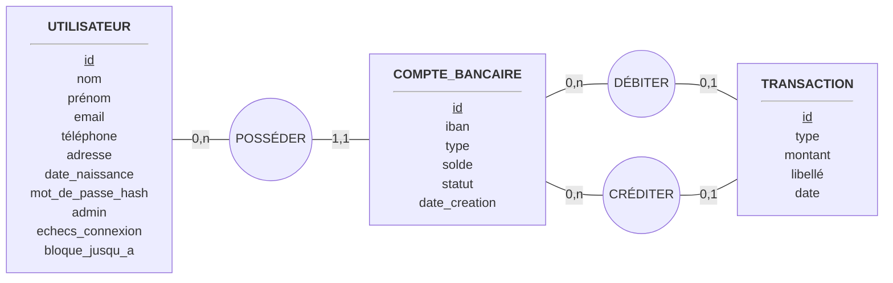
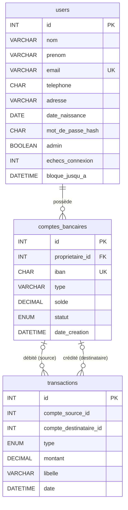

# Modèle de données : MCD et MLD

## 1. MCD (modèle conceptuel, notation Merise)

Trois entités et trois associations. Les cardinalités se lisent « un utilisateur
possède de 0 à n comptes ; un compte est possédé par 1 et 1 seul utilisateur ».

| Association | Lecture |
|---|---|
| POSSÉDER | Un utilisateur possède 0 à n comptes (RG5) ; un compte a exactement un propriétaire. |
| DÉBITER | Un compte est débité par 0 à n transactions ; une transaction débite au plus un compte (aucun pour un dépôt). |
| CRÉDITER | Un compte est crédité par 0 à n transactions ; une transaction crédite au plus un compte (aucun pour un retrait). |

Contrainte : une transaction débite ou crédite au moins un compte. Un virement
débite le compte source et crédite le compte destinataire ; il est enregistré
deux fois (VIREMENT_EMIS et VIREMENT_RECU) pour figurer dans l'historique de
chacun des deux comptes (RG11).

## 2. MLD (modèle logique relationnel)

Clé primaire en **gras**, clé étrangère précédée de `#`.

- **users** (**id**, nom, prenom, email, telephone, adresse, date_naissance,
  mot_de_passe_hash, admin, echecs_connexion, bloque_jusqu_a)
  - email unique
- **comptes_bancaires** (**id**, #proprietaire_id, iban, type, solde, statut,
  date_creation)
  - proprietaire_id référence users(id), suppression en cascade
  - iban unique ; solde ≥ 0
- **transactions** (**id**, compte_source_id, compte_destinataire_id, type,
  montant, libelle, date)
  - montant > 0 ; au moins un des deux comptes renseigné
  - les deux comptes ne sont volontairement pas des clés étrangères : l'historique
    est conservé même après la suppression d'un compte (RG6)
- **compteurs** (**entite**, valeur)
  - table technique : le prochain identifiant de chaque table, jamais réattribué

Passage du MCD au MLD :

- l'association POSSÉDER (1,1 côté compte) devient la clé étrangère
  `proprietaire_id` dans `comptes_bancaires` ;
- DÉBITER et CRÉDITER (0,1 côté transaction) deviennent les colonnes
  `compte_source_id` et `compte_destinataire_id`, qui acceptent NULL.

## 3. Modèle physique (MySQL)

Le script de création est `sql/creation.sql` ; le jeu de données de test est
`sql/donnees_test.sql`.
